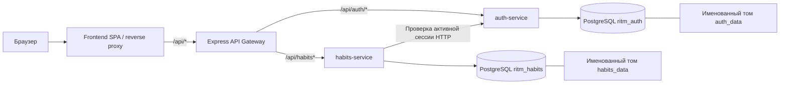

# Ритм — архитектура

Статус: архитектура прошла автоматическую проверку полноты. Основание: [требования](requirements.md), [страницы](pages-spec.md), [утверждённый стек](tech-stack.md), [локальное размещение](deployment-plan.md) и согласованный `prototype/`.

Стек: React + Vite + TypeScript + Tailwind; Node.js + Express + TypeScript; REST/OpenAPI 3.1; PostgreSQL 15+; JWT; Docker Compose. Совместимые поддерживаемые версии закрепляются в образах и lock-файлах при реализации.

## 1. Принципы декомпозиции

| Принцип | Решение |
|---|---|
| Bounded Context | Два доменных сервиса: аккаунты/сессии и привычки/выполнения. |
| Database per Service | Каждый сервис владеет отдельной PostgreSQL-базой, отдельными учётными данными и томом. Чужую базу сервис не читает. |
| Aggregate | `User` и `Session` принадлежат auth-service; привычка с выполнениями — habits-service. |
| Транзакционная целостность | Лимит 25, изменение отметок и каскадное удаление обеспечиваются внутри базы habits-service. |
| Статистика | Серия и месячные показатели вычисляются из выполнений при чтении и после записи. Отдельный analytics-service и асинхронная read-модель не нужны. |
| Связь контекстов | Только HTTP и логические UUID. Межсервисных FK, общей базы, брокера, S3 и распределённых транзакций нет. |
| Соглашения | UUID primary keys, `snake_case` в БД, `created_at`/`updated_at` с UTC-временем на всех таблицах. Календарные даты — тип `date`. |

Два сервиса выбраны по предметной области и согласованному профилю до 10 пользователей. API Gateway — инфраструктурный компонент без своего контекста и базы; он не увеличивает список доменных сервисов.

## 2. Карта компонентов

Снаружи доступна только точка входа frontend, привязанная к loopback. Предлагаемый адрес — `http://localhost:8880`; фактический свободный порт фиксируется при запуске в `state.baseUrl`. До запуска это не заявляется как действующий адрес. API, БД и внутренние проверки сессий доступны только в сети Compose.

## 3. Сервисы, данные и страницы

| Сервис | Bounded Context | База | Агрегаты | Страницы и действия |
|---|---|---|---|---|
| `auth-service` | Identity & Access | `ritm_auth` | `User`, `Session` | `/register`, `/login`; проверка сессии и выход на всех личных страницах. |
| `habits-service` | Habit Tracking | `ritm_habits` | `Habit` с `Completion`; техническая строка владельца для сериализации лимита | `/`: список, отметка сегодня, создание, редактирование, удаление; `/habits/:habitId?month=YYYY-MM`: календарь, история, серия, месячный процент, редактирование и удаление. |

Три модальных экрана не имеют отдельных маршрутов: создание вызывает habits-service; редактирование обновляет только название/описание; подтверждение удаления удаляет привычку и её выполнения одной транзакцией. Ошибки, пустое состояние и неизвестная страница принадлежат frontend. Чужая и несуществующая привычки дают одинаковый `404`.

### 3.1. Данные auth-service

| Таблица | Основные поля и ограничения |
|---|---|
| `users` | `id` UUID PK, уникальный нормализованный `email`, `password_hash`, неизменяемый `time_zone`, `created_at`, `updated_at`. |
| `sessions` | `id` UUID PK, `user_id` FK внутри этой БД, `expires_at`, nullable `revoked_at`, `created_at`, `updated_at`. |

Email нормализуется одинаково при регистрации и входе: trim + lowercase; уникальность защищена БД. Пароль не нормализуется. Хеш — `scrypt` с индивидуальной случайной солью, сохранёнными параметрами и сравнением фиксированного результата без утечки по времени. Реализация использует встроенный `node:crypto`; проектный профиль: `N=131072`, `r=8`, `p=1`, соль 16 байт, результат 64 байта, `maxmem=256 MiB`. Параметры входят в формат хеша, чтобы не зависеть от будущего изменения значений по умолчанию. Поддержка параметров и соли описана в [Node.js Crypto](https://nodejs.org/api/crypto.html#cryptoscryptpassword-salt-keylen-options-callback).

При регистрации backend проверяет, что переданный браузером `timeZone` поддерживается как IANA-зона, и сохраняет его. Смена пояса, профиля, email и пароля не вводится. Регистрация создаёт аккаунт, после чего пользователь входит отдельно, как в прототипе. Почта, верификация, восстановление и публичные demo-аккаунты в рабочую версию не переносятся.

### 3.2. Данные habits-service

| Таблица | Основные поля и ограничения |
|---|---|
| `habit_owners` | `id` UUID PK, логически равен `users.id` из auth-service, `created_at`, `updated_at`. Только локальный ключ блокировки операций владельца; не копия аккаунта. |
| `habits` | `id` UUID PK, `user_id` FK на локальную `habit_owners.id`, `name`, `description`, неизменяемый `start_date`, `created_at`, `updated_at`. Индекс по `(user_id, created_at, id)` для стабильного списка. |
| `completions` | `id` UUID PK, `habit_id` FK внутри этой БД с `ON DELETE CASCADE`, `completed_on` date, `created_at`, `updated_at`. Уникальность `(habit_id, completed_on)`. |

Неотмеченный день представлен отсутствием строки, а не отрицательным событием. Число отметок, серии и проценты не хранятся как независимые счётчики. Иконки и цвета прототипа — оформление frontend; они не создают новых полей формы или категорий продукта.

**Лимит 25:** при первом обращении владельца habits-service создаёт локальную `habit_owners` через `INSERT ... ON CONFLICT DO NOTHING`. Создание и удаление привычки берут эту строку `FOR UPDATE` в транзакции. Создание после блокировки считает существующие привычки и либо вставляет новую, либо возвращает конфликт лимита. При 24 привычках два одновременных запроса не смогут создать 26-ю. Механизм блокировок строк определён в [документации PostgreSQL](https://www.postgresql.org/docs/current/explicit-locking.html).

**Выполнения:** изменение блокирует собственную привычку, проверяет владельца, после получения блокировки заново определяет текущую дату и проверяет окно. Установка использует идемпотентную запись желаемого состояния (`completed: true/false`), а не серверное «переключить». Повторная доставка запроса не переворачивает отметку. Удаление привычки каскадно удаляет отметки; отдельный процесс очистки не нужен.

## 4. Межсервисные связи и авторизация

`habits.user_id` — логическая ссылка на UUID пользователя auth-service. Через границу БД нет FK, join, прямого доступа или репликации персональных данных. Удаление аккаунта не входит в требования, поэтому распределённый сценарий удаления пользователя не создаётся.

Выбран конкретный вариант с JWT в cookie и отзывными сессиями:

1. Auth-service проверяет пароль, сохраняет `sessions` и выдаёт подписанный HS256 JWT с `sub=user_id`, `sid=session_id`, `iss=ritm-auth`, `aud=ritm-app`, `iat`, `exp`. Срок сессии и JWT — 7 суток, без refresh-token. После истечения нужен повторный вход. Signing secret генерируется один раз для локального окружения, не включается в исходники и сохраняется между перезапусками.
2. Cookie `ritm_session` имеет `HttpOnly`, `SameSite=Lax`, `Path=/`, ограниченный срок жизни и не задаёт `Domain`. `Secure=false` разрешается только для выбранного локального HTTP-окружения; вне него требуется HTTPS и `Secure=true`. Cookie не читается JavaScript и не сохраняется дополнительно в localStorage/sessionStorage. Поведение атрибутов описано в [MDN Set-Cookie](https://developer.mozilla.org/en-US/docs/Web/HTTP/Reference/Headers/Set-Cookie).
3. Auth-service на каждом своём защищённом запросе проверяет алгоритм, подпись, issuer, audience, срок JWT и соответствующую активную строку `sessions` с совпадающим пользователем. `GET /api/auth/session` возвращает безопасный профиль: UUID, email, сохранённый пояс и срок сессии; токен и хеш не возвращаются.
4. Habits-service также проверяет JWT с разрешённым HS256, issuer/audience/exp и затем вызывает `POST /internal/sessions/verify` auth-service. Внутренний вызов защищён отдельным случайным service-key и доступен только в сети Compose. Auth-service проверяет JWT и сессию и возвращает подтверждённые `userId`, `sessionId`, `timeZone`. Habits-service сверяет идентичность с JWT и использует подтверждённый пояс. Проверка выполняется **на каждом** защищённом запросе, без кэша. Client-supplied user ID, timezone и `X-User-*` заголовки не являются источником прав.
5. Logout отзывает текущую строку сессии в БД и очищает cookie с теми же Path/атрибутами. Скопированный до выхода JWT после подтверждённого отзыва больше не работает. Отзыв не завершает другие сессии пользователя. Если cookie отсутствует, выход остаётся безопасным и очищает его; ответ об успешном отзыве действующей сессии не выдаётся при недоступной БД.
6. Недействительная или отозванная сессия даёт `401`; frontend удаляет личное состояние и возвращает на вход. Недоступный auth-service или БД дают `503`, а не ложный `401` и не разрешение продолжить операцию. После выхода локальное состояние очищается; при прямом открытии страницы сессия проверяется до загрузки личных данных.

Для небольшой локальной установки дополнительный синхронный запрос проверки сессии — принятый компромисс ради немедленного отзыва и отсутствия брокера. Оба доменных сервиса находятся в одной доверенной внутренней сети, но каждый защищённый обработчик проверяет полномочия; gateway не передаёт неподписанные заголовки идентичности как доказательство доступа.

## 5. Доменные события

| Факт | Владелец | Внешние подписчики | Обработка в MVP |
|---|---|---|---|
| `UserRegistered` | auth-service | Нет | Коммит аккаунта. habits-service не создаёт данные до первого обращения владельца. |
| `SessionCreated` / `SessionRevoked` | auth-service | Нет | Состояние в `sessions`; проверяется синхронным HTTP-запросом. |
| `HabitCreated` / `HabitUpdated` | habits-service | Нет | Коммит одной базы, затем обновление ответа и UI. |
| `CompletionSet` | habits-service | Нет | Идемпотентная запись и вычисление актуальных показателей из БД. |
| `HabitDeleted` | habits-service | Нет | Каскадное удаление в транзакции; освободившийся слот виден сразу. |

Это таблица доменных фактов и точек расширения, а не обязательство реализовать транспорт. Брокера, event store, outbox и асинхронной доставки нет. На события не завязаны права, каскадное удаление, лимит или актуальность статистики. Производственные логи содержат технический результат и request ID, но не пароли, JWT, service-key или cookie.

## 6. API Gateway / BFF и единый origin

- Frontend раздаёт сборку SPA и проксирует `/api/*` на Express Gateway. Роуты страниц (`/login`, `/register`, `/`, `/habits/:habitId`) получают SPA fallback. Неизвестный API-маршрут возвращает JSON `404`, а не `index.html`.
- Gateway маршрутизирует только публичные пути `/api/auth/*` и `/api/habits*` с сохранением пути и передаёт cookie/Set-Cookie. Маршрут `/internal/*` не публикуется. Произвольный URL upstream от клиента не принимается.
- Gateway задаёт request ID, ограничивает размер JSON, контролирует таймауты upstream и возвращает единый безопасный формат ошибок. Заголовки идентичности от клиента удаляются; авторизация остаётся обязанностью доменных сервисов.
- Браузер и API работают на одном origin; frontend использует cookie credentials и относительные `/api/*`. CORS для внешних origin не включается. Токены не попадают в URL.
- Все браузерные изменяющие запросы, включая регистрацию, вход и выход, требуют `Origin`, точно равный настроенному `APP_ORIGIN`. Отсутствующий, `null` или чужой Origin отклоняется с `403`. JSON-запросы с телом требуют `Content-Type: application/json`. Gateway проверяет это до proxy; публичные обработчики сервисов повторяют проверку. Внутренний session-verify использует service-key и не является браузерным API.
- `APP_ORIGIN` задаётся по фактическому локальному URL, не выводится из присланных клиентом Host/X-Forwarded-* заголовков. Smoke-тесты с curl передают тот же Origin для изменяющих операций. Различие localhost и 127.0.0.1 учитывается как различие origin и cookie-host.

## 7. Календарь, серия и API-данные

Источник календарного «сегодня» — UTC-время backend, преобразованное в сохранённую IANA-зону аккаунта. Браузерные часы и переданный при отметке timezone не определяют разрешённое окно. После ожидания блокировки backend заново получает время перед изменением и использует одну дату `D` для проверки и ответа.

- `start_date` фиксируется сервером при создании привычки. Разрешённая дата изменения принадлежит `[max(start_date, D−7), D]` включительно. Дата должна существовать в календаре; разница считается по датам, без деления миллисекунд на 24 часа. Установка и снятие используют одно окно.
- Серия: если выполнено D — непрерывная цепочка назад от D; иначе цепочка от D−1, если он выполнен; иначе 0. Не ограничивается выбранным месяцем. Перечитывается после изменения и при смене суток.
- Месячный процент: `число выполненных дат выбранного месяца / полное число дней этого месяца × 100`, включая будущие дни текущего месяца. Отображение — один знак после запятой; API возвращает также исходные числитель и знаменатель. История доступна от месяца создания до текущего, месяц без выполнений имеет 0%.
- Список возвращает сегодняшнее состояние и серию каждой привычки, последние даты для компактного недельного обзора, серверные `today` и `timeZone`. Календарный запрос возвращает выбранный месяц, выполненные даты, границы редактирования и месячные показатели. Полная многолетняя история не требуется в каждом ответе списка.
- Изменение отметки возвращает подтверждённое состояние и актуальные показатели либо инициирует их перечитывание в frontend. После ошибки интерфейс сохраняет последнее подтверждённое состояние. Конкретные DTO и статусы валидации фиксируются на следующем этапе OpenAPI, без изменения этих правил.

## 8. Локальный запуск, сохранность и проверки

Docker Compose содержит frontend/reverse proxy, gateway, два доменных сервиса и два PostgreSQL-контейнера. Два именованных тома сохраняют данные между перезапусками и пересозданием контейнеров. Обычные команды остановки/обновления не удаляют тома. Учётные данные БД, signing secret и внутренний service-key находятся в локальном игнорируемом окружении; пример конфигурации содержит только placeholders. Рабочие БД не содержат автоматически созданного публичного demo-пользователя из прототипа.

Миграции принадлежат своему сервису, версионируются и выполняются до readiness. Повторный запуск не очищает данные. Health/readiness каждого сервиса проверяет собственную БД и завершение миграций; gateway/frontend готовы после доступности upstream. Compose использует healthchecks и зависимости readiness. Предлагаемый внешний порт проверяется перед выбором и публикуется только на loopback; БД не публикуются на хосте.

Порядок проверок:

1. Backend unit/API и интеграционные тесты на отдельных тестовых БД: регистрация/вход/отзыв, изоляция пользователей, лимит при конкурентном создании, идемпотентность отметок, D−7/дата создания/будущее, DST/смена года/високосный месяц, серия, полный знаменатель, каскадное удаление. Тестовые часы внедряются явно; рабочий API не принимает произвольное «сегодня» от клиента.
2. Только после `tests.backend = passed` — live-интеграция frontend с API, сохранение согласованного оформления и форм. Демо-вход и in-memory store из прототипа заменяются реальной сессией и запросами.
3. Compose развёрнут локально, все компоненты healthy. Smoke обращается через фактический `$baseUrl/api/*`: без сессии защищённый путь даёт `401`, а не `404`; после входа чтение/изменение работают. Проверяется сохранность после перезапуска контейнеров без удаления томов.
4. Playwright выполняется с exit 0 против полного `state.baseUrl`, включая порт, на всех четырёх маршрутах и модальных сценариях. Только затем фиксируются `tests.frontend = passed`, `e2eLastRun`, deploy-log и итоговый адрес. Проверка UI-прототипа не подменяет эти результаты.

## 9. Принятые ограничения

Недоступность auth-service останавливает защищённые запросы habits-service: это явная синхронная зависимость, приемлемая для согласованной нагрузки. Отсутствие восстановления пароля и проверки владения email следует требованиям. При утрате локальных томов потребуется резервная копия; их автоматическое удаление или скрытая очистка при обновлении не допускаются. Требования к удалённому HTTPS-размещению, CI, резервному расписанию и массовой нагрузке не добавляются в текущую реализацию.
